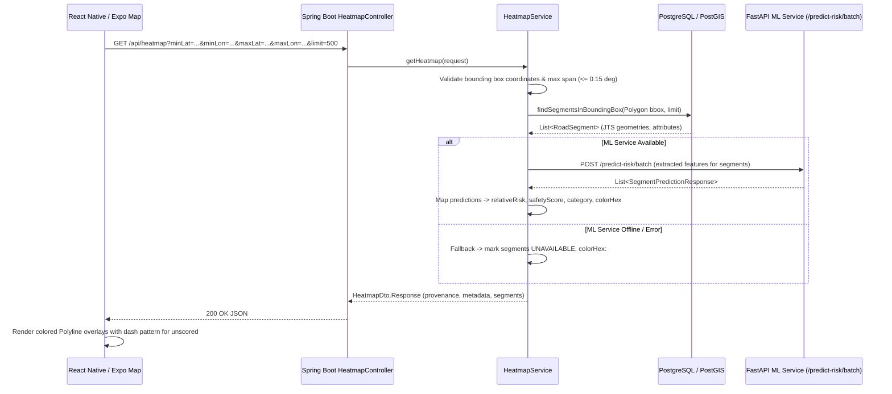

# SafePath AI — Milestone 20: Safety Heatmap Specification & Documentation

> **Status:** Stable (Milestone 20 Complete)  
> **Author:** SafePath AI Development Team  
> **Scope:** Spatial Heatmap Architecture, Bounding Box Contracts, ML Risk Overlays, and Mobile Visualization

---

## 1. Overview & Architectural Principles

The **Safety Heatmap** provides an interactive spatial visualization of relative road-segment safety across urban networks. Unlike traditional "crime heatmaps" that plot density of historical police reports as blurry raster clouds, SafePath AI's safety heatmap renders vector road segments colored by multi-factor relative risk estimates derived from spatial features (lighting, activity proxy, crime proximity, and temporal context).

### 1.1 Non-Negotiable Data Integrity Principles

In compliance with `AGENTS.md` and the project contract:

1. **Estimates vs Crime Probabilities:** Model-predicted risk scores are relative feature-weighted estimates, **not** calibrated actuarial crime probabilities.
2. **Concept Separation:** Model-predicted road risk, historical crime density, community incident reports, and verified ground-truth observations remain distinct concepts and are never conflated.
3. **No Default Safety for Missing Data:** Streets without observations or when the ML service is offline are explicitly designated as `UNSCORED` or `UNAVAILABLE` and rendered in neutral dashed gray (`#8E8E93`). They are **never** assigned an arbitrary "safe" or low-risk default score.
4. **Synthetic Demonstration Disclosure:** Because production models were trained on synthetic demonstration fixtures (`mock_training_dataset.csv`), the UI and API explicitly display the `DEMO ML MODEL` provenance flag.
5. **No Visual Hallucination:** If road segments or geometry are unavailable for a bounding box, an empty collection is returned rather than fabricated coordinates.

---

## 2. Spatial Data Flow

---

## 3. API Contract & Validation Rules

### 3.1 Endpoint

- **Primary Route:** `GET /api/heatmap`
- **Alias Route:** `GET /api/routes/heatmap`

### 3.2 Query Parameters

| Parameter | Type | Required | Constraints | Description |
|-----------|------|----------|-------------|-------------|
| `minLat` | `Double` | Yes | $[-90.0, 90.0]$ | South latitude boundary (WGS84) |
| `minLon` | `Double` | Yes | $[-180.0, 180.0]$ | West longitude boundary (WGS84) |
| `maxLat` | `Double` | Yes | $[-90.0, 90.0]$ | North latitude boundary (WGS84) |
| `maxLon` | `Double` | Yes | $[-180.0, 180.0]$ | East longitude boundary (WGS84) |
| `limit` | `Integer` | No | Default: 500, Range: $[1, 1000]$ | Maximum segments to return |

### 3.3 Spatial Validation & Guardrails

To prevent memory exhaustion and database overload:
- **Ordering Constraint:** `minLat <= maxLat` and `minLon <= maxLon`.
- **Viewport Span Limit:** `(maxLat - minLat) <= 0.15` and `(maxLon - minLon) <= 0.15` ($\approx 16.5 \times 16.5\text{ km}$). Requests exceeding this threshold are rejected with HTTP 400 Bad Request.
- **Segment Limit Clamping:** Values exceeding 1,000 are clamped to 1,000; non-positive values default to 500.

### 3.4 Geometry & Coordinate Reference System

- **CRS:** EPSG:4326 (WGS84).
- **Format:** Both GeoJSON LineString format (`[longitude, latitude]`) and mobile coordinate list (`[{ latitude, longitude }]`) are serialized for seamless multi-platform consumption.

---

## 4. Risk Categories, Scores, and Color Mapping

The backend derives safety scores and categories using documented application thresholds:

$$\text{Safety Score} = (1.0 - \text{Relative Risk}) \times 100$$

| Category | Safety Score | Relative Risk Range | Color Hex | Visual Description |
|----------|--------------|---------------------|-----------|--------------------|
| `VERY_LOW` | $80.0 - 100.0$ | $[0.00, 0.20]$ | `#34C759` | Solid green |
| `LOW` | $60.0 - 79.9$ | $(0.20, 0.40]$ | `#34C759` | Solid green |
| `MODERATE` | $40.0 - 59.9$ | $(0.40, 0.60]$ | `#FF9500` | Solid amber |
| `HIGH` | $20.0 - 39.9$ | $(0.60, 0.80]$ | `#FF3B30` | Solid red |
| `VERY_HIGH` | $0.0 - 19.9$ | $(0.80, 1.00]$ | `#D70015` | Solid dark crimson |
| `UNSCORED` / `UNAVAILABLE` | `null` | `null` | `#8E8E93` | Dashed slate gray (`lineDashPattern: [6, 4]`) |

> [!IMPORTANT]
> A green overlay (`#34C759`) indicates relatively lower estimated risk according to feature inputs, **not** guaranteed safety. Street lighting or activity missing from OSM is treated as unobserved rather than verified absence.

---

## 5. Mobile Visualization Experience

The mobile implementation in `mobile/app/(tabs)/index.tsx` provides a responsive, accessible map experience:

1. **Heatmap Toggle:**
   - Prominent header switch: `🔥 Heatmap: ON / ⚪ Heatmap: OFF`.
   - Accessible roles (`switch`) and state announcements (`checked`).
2. **Viewport-Based Debounced Fetching:**
   - On map region change, coordinates are debounced by 600ms.
   - If viewport span exceeds $0.14^\circ$, a warning banner advises the user to zoom in and offers a one-tap jump to central Bangalore.
3. **Collapsible Legend & Academic Disclaimers:**
   - Detailed color cards explaining score ranges and category thresholds.
   - Academic disclosures highlighting synthetic model demonstration, non-probabilistic scoring, and missing data policies.
4. **Segment Inspection Card:**
   - Tapping any segment highlights it (stroke width 6, blue border) and opens a bottom card showing segment name, highway type, safety score, relative risk, lighting status, model version, and synthetic estimate warnings.
5. **Route Coexistence:**
   - Demonstrated in both the Map tab (via `🧭 Route Test` coexistence toggle) and the Route Comparison tab (`mobile/app/(tabs)/routes.tsx`), where the heatmap overlay can be toggled on underneath active route polylines.
6. **Graceful State Handling:**
   - Loading indicator badge during viewport updates.
   - Network error banners with retry action.
   - Empty state banners with "Jump to Bangalore MG Rd" shortcut.
   - Location permission denial fallback to default Bangalore coordinates.

---

## 6. Verification & Test Suite

### 6.1 Backend Tests (`backend/`)
- `HeatmapServiceTest`:
  - `getHeatmap_validBoundingBox_returnsScoredSegments`: Validates complete flow with mocked ML batch predictions, correct scores, categories, and colors.
  - `getHeatmap_mlServiceUnavailable_returnsUnscoredSegments`: Validates fallback to `UNAVAILABLE` status, null risk scores, and `#8E8E93` color when ML service fails.
  - `getHeatmap_emptyRoadNetwork_returnsEmptyResponse`: Validates empty bounding boxes without crashing.
  - `getHeatmap_invalidLatitudeBounds_throwsValidationException`: Validates latitude boundaries $[-90, 90]$.
  - `getHeatmap_invertedBounds_throwsValidationException`: Validates `min <= max` constraint.
  - `getHeatmap_exceededSpanLimit_throwsValidationException`: Rejects bounding boxes $> 0.15^\circ$ span.
  - `getHeatmap_limitClamped_correctlyAppliesLimits`: Ensures segment limits are bounded to $[1, 1000]$.
  - `getHeatmap_riskCategoryThresholds_mappedCorrectly`: Tests all 5 risk category thresholds.
- `HeatmapControllerTest`:
  - `getHeatmap_success`: Integration test for `GET /api/heatmap`.
  - `getRoutesHeatmap_aliasSuccess`: Integration test for `GET /api/routes/heatmap` alias.
- **Backend Test Result:** 57 tests passed, 0 failures, 0 errors.

### 6.2 Mobile TypeScript Verification (`mobile/`)
- `npx tsc --noEmit`: Clean compilation with 0 errors across all screens and services.

### 6.3 ML Service Tests (`ml-service/`)
- `pytest ml-service/tests`: 15 passed in 13.4s with 100% success rate.

---

## 7. Known Limitations & Runtime Notes

- **Synthetic Training Data:** The ML models are trained on deterministic synthetic fixtures. Real-world crime density is not represented until genuine crime feeds are ingested.
- **Physical Device Rendering:** Static compilation and unit tests verify complete component and API integration. Visual runtime testing on physical Android/iOS hardware remains subject to device availability.
