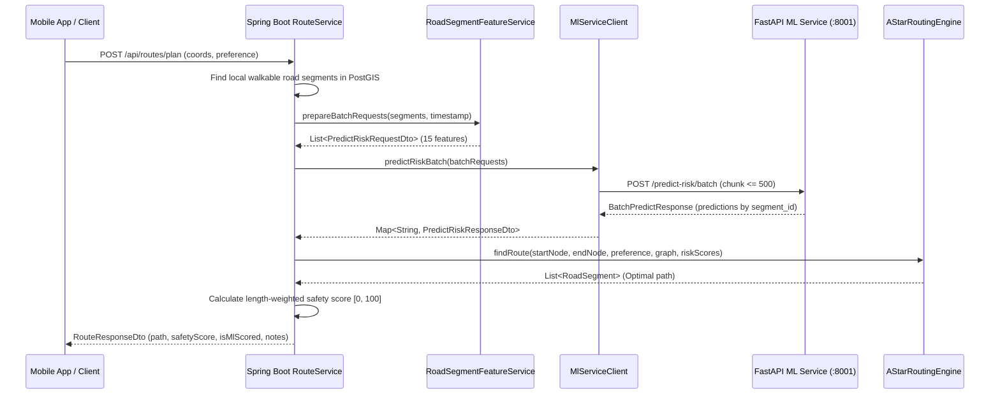

# SafePath AI — Spring Boot ↔ FastAPI ML Integration Specification

## 1. Overview & Service Responsibilities

SafePath AI employs a dual-service architecture designed to preserve software engineering modularity, thread safety, and scientific honesty:

| Layer / Service | Runtime | Key Responsibilities |
|---|---|---|
| **Spring Boot Monolith** (`:8080`) | Java 21 / Spring Boot 3.3.4 | User authentication (JWT), routing network graph construction, road-segment feature extraction, multi-objective A* route optimization, safety score aggregation, and safe fallback handling. |
| **FastAPI ML Service** (`:8001`) | Python 3.11 / FastAPI | Feature imputation, model inference (XGBoost / Random Forest baseline), SHAP explanation calculation, and additive validation. |

Spring Boot calls FastAPI over HTTP via `RestClient`. Machine learning training, weights fitting, and SHAP tree traversal never occur inside Spring Boot or on mobile devices.



---

## 2. Exact Request & Response JSON Contracts

All inter-service payloads strictly conform to the 15-feature schema established in `ml-service/app/models/schemas.py`.

### 2.1 Single Risk Prediction (`POST /predict-risk`)

**Request Payload:**
```json
{
  "segment_id": "seg-101",
  "features": {
    "crime_density_500m": 0.25,
    "crime_density_1km": 0.40,
    "severity_weighted_density": 0.15,
    "recent_crime_density": 0.10,
    "night_crime_density": 0.08,
    "hour_of_day": 21,
    "day_of_week": 5,
    "lighting_score": 0.85,
    "activity_proxy": 0.70,
    "nearest_police_m": 600.0,
    "nearest_hospital_m": 1200.0,
    "nearest_transport_m": 350.0,
    "weather_precipitation": 0.0,
    "weather_visibility": 10.0,
    "verified_report_count": 2
  }
}
```

**Response Payload:**
```json
{
  "segment_id": "seg-101",
  "raw_model_output": 0.32,
  "risk_score": 0.32,
  "safety_score": 0.68,
  "risk_level": "LOW",
  "model_type": "xgboost",
  "model_version": "v1.0.0",
  "model_trained_at": "2026-10-12T10:00:00",
  "feature_completeness": 1.0,
  "imputed_features": [],
  "is_synthetic_demonstration": true,
  "demo": false
}
```

### 2.2 Batch Risk Prediction (`POST /predict-risk/batch`)

**Request Payload:**
```json
{
  "segments": [
    {
      "segment_id": "seg-101",
      "features": { ... }
    },
    {
      "segment_id": "seg-102",
      "features": { ... }
    }
  ]
}
```

**Response Payload:**
```json
{
  "predictions": [
    {
      "segment_id": "seg-101",
      "raw_model_output": 0.32,
      "risk_score": 0.32,
      "safety_score": 0.68,
      "risk_level": "LOW",
      "model_type": "xgboost",
      "model_version": "v1.0.0",
      "is_synthetic_demonstration": true
    }
  ],
  "count": 1
}
```

### 2.3 SHAP Explanation (`POST /explain`)

**Response Payload:**
```json
{
  "segment_id": "seg-101",
  "raw_model_output": 0.72,
  "risk_score": 0.72,
  "safety_score": 0.28,
  "base_risk": 0.28,
  "model_type": "xgboost",
  "model_version": "v1.0.0",
  "factors": [
    {
      "name": "lighting_score",
      "value": 0.10,
      "raw_value": 0.10,
      "contribution": 0.22,
      "direction": "increases_risk",
      "description": "Poor lighting is statistically associated with higher relative risk in training distribution.",
      "is_imputed": false
    }
  ],
  "reconstruction_valid": true,
  "reconstruction_error": 0.00001,
  "is_synthetic_demonstration": true,
  "disclaimer": "These explanations reflect statistical attributions in the model, not direct measurements of real-world safety.",
  "causality_warning": "SHAP attributions describe statistical associations, not physical real-world causation."
}
```

---

## 3. Environment Variables & Configuration

Configuration is managed via Spring `@ConfigurationProperties(prefix = "safepath.ml-service")` backed by environment variable substitution:

| Environment Variable | Property Key | Default Value | Description |
|---|---|---|---|
| `ML_SERVICE_URL` | `safepath.ml-service.url` | `http://localhost:8001` | Base URL of the FastAPI ML inference service |
| `ML_SERVICE_TIMEOUT_MS` | `safepath.ml-service.timeout-ms` | `5000` | Socket read timeout in milliseconds |
| `ML_SERVICE_CONNECT_TIMEOUT_MS` | `safepath.ml-service.connect-timeout-ms` | `3000` | TCP connection timeout in milliseconds |
| `ML_SERVICE_MAX_BATCH_SIZE` | `safepath.ml-service.max-batch-size` | `500` | Upper limit on segments per batch request chunk |
| `ML_SERVICE_ENABLED` | `safepath.ml-service.enabled` | `true` | Feature flag to enable/disable ML integration |

### Local Startup

1. **Start FastAPI ML service:**
   ```powershell
   cd ml-service
   .\venv\Scripts\uvicorn app.main:app --host 0.0.0.0 --port 8001
   ```
2. **Start Spring Boot backend:**
   ```powershell
   cd backend
   .\mvnw.cmd spring-boot:run
   ```

---

## 4. Timeout, Batching, & Error Handling Policy

### 4.1 Bounded Chunking
FastAPI rejects requests with $> 500$ segments with HTTP 422 to protect memory. `MlServiceClientImpl` chunks requests larger than `maxBatchSize` into slices of $\le 500$, dispatches them sequentially, and merges the responses into a single map keyed by `segment_id`.

### 4.2 Out-of-Order Segment Matching
FastAPI responses or parallel sub-batches may return predictions in arbitrary order. `MlServiceClientImpl` stores predictions in a `Map<String, PredictRiskResponseDto>` keyed strictly by `segmentId`. Predictions are never matched by array index.

### 4.3 Error Classification & Propagation

| Error Scenario | Root Cause / Status | Java Exception Thrown |
|---|---|---|
| ML Service Unreachable | TCP Connection Refused / Connect Timeout | `MlServiceUnavailableException` (HTTP 503) |
| Prediction Timeout | Socket Read Timeout ($> 5000$ms) | `MlServiceUnavailableException` (HTTP 503) |
| Models Not Ready | FastAPI returns HTTP 503 Service Unavailable | `MlServiceUnavailableException` (HTTP 503) |
| Schema / Field Rejection | FastAPI returns HTTP 400 or HTTP 422 | `MlServiceValidationException` (HTTP 400) |
| Explainer Unsupported | FastAPI returns HTTP 501 Not Implemented | `MlServiceException` (HTTP 501) |
| Internal ML Error | FastAPI returns HTTP 500 | `MlServiceException` (HTTP 500) |

---

## 5. Safe Fallback Policy

Per `AGENTS.md` and scientific honesty constraints:

> **Data Integrity Rule:** "Distinguish 'risk prediction unavailable' from 'low risk'. Never label an unscored segment safe. Do not silently substitute fabricated risk values when the ML service fails."

### Policy by Routing Preference:

1. **`RoutePreference.SAFEST`:**
   - **Policy:** **Strict Rejection.**
   - If `MlServiceClient` throws `MlServiceUnavailableException` or `MlServiceException`, `RouteService` immediately throws `MlServiceUnavailableException`.
   - **Rationale:** The system must never mislead a user by claiming a route calculated without risk predictions is the `SAFEST` route.

2. **`RoutePreference.FASTEST`:**
   - **Policy:** **Independent Non-ML Routing.**
   - In `FASTEST` mode, the multi-objective cost weights are $\alpha = 0.8$ (time), $\beta = 0.2$ (distance), $\gamma = 0.0$ (risk).
   - If the ML service is down, `RouteService` logs a warning and proceeds with network travel-time routing.
   - The resulting `RouteResponseDto` is clearly labeled:
     - `isMlScored = false`
     - `safetyScore = null`
     - `riskLevel = "UNSCORED"`
     - `notes = "FASTEST route prioritized travel time independently of risk scoring."`

3. **`RoutePreference.BALANCED`:**
   - **Policy:** **Degraded Non-ML Fallback with Explicit Unscored Marking.**
   - If ML fails, the route engine falls back to physical road network distance/time edge weights.
   - The response is marked with `isMlScored = false`, `safetyScore = null`, and `riskLevel = "UNSCORED"`. It is never presented as safety-evaluated.

---

## 6. Route Safety Score Derivation

- **FastAPI output:** Returns single segment `risk_score` in $[0.0, 1.0]$ and single segment `safety_score = 1.0 - risk_score`.
- **Spring Boot aggregate:** For a chosen path of road segments $\{s_1, \dots, s_k\}$ with lengths $L_i$:
  $$\text{avgSafety} = \frac{\sum_{i=1}^k \text{safetyScore}_i \times L_i}{\sum_{i=1}^k L_i}$$
  $$\text{Route Safety Score (0–100)} = \text{round}(\text{avgSafety} \times 100, 1)$$
- **Risk Level Categorization (Application-Defined):**
  - $\text{Risk} < 0.20 \implies$ `VERY_LOW`
  - $\text{Risk} < 0.40 \implies$ `LOW`
  - $\text{Risk} < 0.60 \implies$ `MODERATE`
  - $\text{Risk} < 0.80 \implies$ `HIGH`
  - $\text{Risk} \ge 0.80 \implies$ `VERY_HIGH`

---

## 7. How to Run Integration & Unit Tests

### Spring Boot Backend Tests
```powershell
cd backend
.\mvnw.cmd test
```
All tests use `MockRestServiceServer` and Mockito mocks. No running FastAPI instance is required during automated CI/CD builds.

### FastAPI & Model Tests
```powershell
ml-service\venv\Scripts\python -m pytest -v
```

---

## 8. Limitations & Scientific Honesty

1. **Synthetic Demonstration Notice:** The underlying XGBoost and Random Forest models were trained on synthetic test fixtures (`is_synthetic_demonstration = true`). All scores are relative rankings within demonstration distributions, not absolute real-world safety probabilities.
2. **Missing Feature Imputation:** When real-time lighting, crowd activity, or weather features are absent, the preprocessor imputes median defaults (`0.50` lighting, `0.50` activity). This is tracked via `imputed_features` in prediction responses.
3. **Non-Causal Interpretability:** SHAP feature attributions describe mathematical feature contributions to the model's prediction score, not causal levers. Increasing lighting or police presence does not deterministically reduce crime in the real world.
